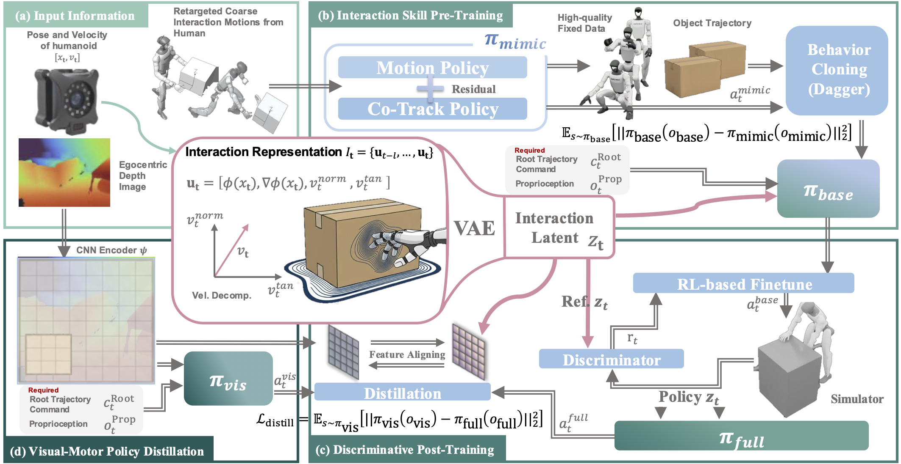

[](https://lessmimic.github.io)
<div id="top" align="left">

[](https://arxiv.org/abs/2602.21723)
[](https://lessmimic.github.io/static/pdfs/lessmimic.pdf)
[](https://lessmimic.github.io/)
[](https://lessmimic.github.io/#live-demo-section)
</div>

# LessMimic: Versatile Humanoid–Object Interaction with Unified Distance Field Representations

[Yutang Lin](https://yutang-lin.github.io/)\*,
[Jieming Cui](https://jiemingcui.github.io/)\*,
[Yixuan Li](https://yixxuan-li.github.io/),
Wei Liang,
[Baoxiong Jia](https://buzz-beater.github.io/)&dagger;,
[Yixin Zhu](https://yzhu.io/)&dagger;,
[Siyuan Huang](https://siyuanhuang.com/)&dagger;

<sub>\* Equal contribution &nbsp; &dagger; Corresponding author</sub>

## Abstract

Versatile whole-body interaction between humanoid robots and everyday objects is a central goal of embodied intelligence. Existing methods often rely on motion-reference inputs or task-specific rewards, which couple each policy to particular motion scripts, object geometries, and contact timings. This coupling limits both geometric generalization and flexible interaction control, in which simple commands specify the motion intent and the object geometry determines how contact is executed. Here we present LessMimic, a framework for versatile humanoid–object interaction that requires no motion reference at inference. A single whole-body policy is steered by root-velocity commands and an interaction-type flag, and it is conditioned on a compact interaction representation built from short histories of surface distances and local surface directions queried from a Distance Field (DF). This geometry-conditioned interface lets the commands set the motion intent while contact behavior adapts to the local object geometry. Visual distillation further transfers the interface to egocentric depth, which yields a variant that deploys without Motion Capture (MoCap). Across object scales from 0.4× to 1.6×, LessMimic performs robustly on four interaction tasks (PickUp, SitStand, Push, and Carry), whereas motion-conditioned baselines degrade sharply away from the training scale. The same policy also composes heterogeneous skills in sequence, succeeding on 62.1% of five-task sequences and on 23.5% of sequences with 15 task instances. Grounding interaction control in local geometry rather than in motion references thus offers a path toward humanoid–object control that generalizes across geometries, follows simple commands, and composes heterogeneous skills.

## Code

Code will be released. Stay tuned.

## Citation

```bibtex
@inproceedings{lin2026lessmimic,
  title={LessMimic: Versatile Humanoid–Object Interaction with Unified Distance Field Representations},
  author={Lin, Yutang and Cui, Jieming and Li, Yixuan and Liang, Wei and Jia, Baoxiong and Zhu, Yixin and Huang, Siyuan},
  booktitle={Advances in Neural Information Processing Systems},
  year={2026},
  url={https://arxiv.org/abs/2602.21723}
}
```
